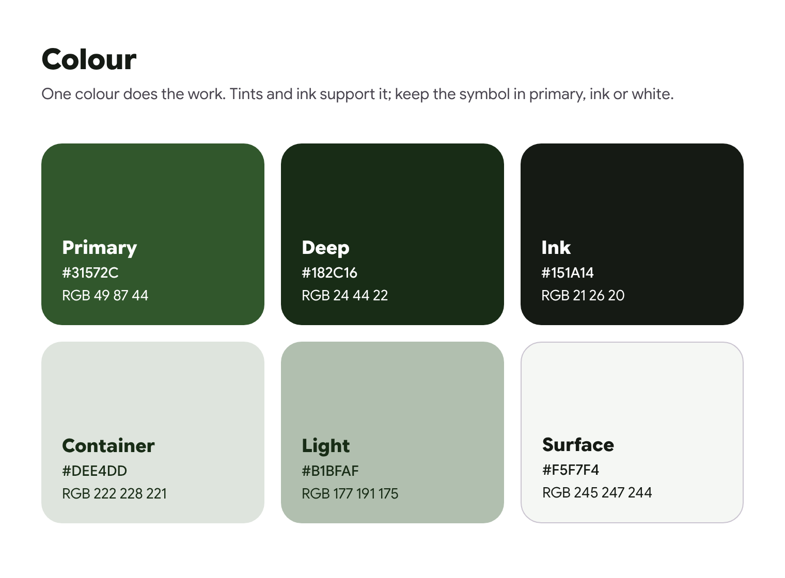

# Branding and colour scheme

The brand source of truth is the [`kalaoapp/branding`](https://github.com/kalaoapp/branding) repository (logos, symbol, icons, patterns, social, stationery and the guideline sheets). This repo keeps only what the app and docs use: the guideline sheets and a few logos in [`branding/`](branding/), and the symbol PNGs in `android/assets/branding/`. When the brand changes, update it there first and copy the affected files here.

## Colour

"One colour does the work. Tints and ink support it; keep the symbol in primary, ink or white." ([guideline sheet](branding/guidelines/colour.png))

| Name | Hex | RGB | Use |
| --- | --- | --- | --- |
| Primary ("fern") | `#31572C` | 49 87 44 | The brand colour: app icon tile, primary buttons and highlights in light mode, the active lyric line |
| Deep | `#182C16` | 24 44 22 | Text and icons on the light tints |
| Ink | `#151A14` | 21 26 20 | Darkest neutral: text on light surfaces, the dark-mode page |
| Container | `#DEE4DD` | 222 228 221 | Light tint behind primary content (chips, selected items, cards) |
| Light | `#B1BFAF` | 177 191 175 | Mid tint: the primary colour on dark surfaces |
| Surface | `#F5F7F4` | 245 247 244 | Light-mode page colour and launch background |

### App colour scheme (Material 3)

`AppTheme.seededScheme` (`lib/theme/app_theme.dart`, tokens in `lib/theme/app_tokens.dart`) builds a Material 3 tonal scheme from Primary, then pins the roles the brand defines. Roles not listed (secondary, tertiary, error, outline, the surface-container ladder) come from that tonal palette, so they stay in harmony with the green.

| Material role | Light | Dark |
| --- | --- | --- |
| `primary` | Primary `#31572C` | Light `#B1BFAF` |
| `onPrimary` | white | Deep `#182C16` |
| `primaryContainer` | Container `#DEE4DD` | Primary `#31572C` |
| `onPrimaryContainer` | Deep `#182C16` | Container `#DEE4DD` |
| `surface` | Surface `#F5F7F4` | Ink `#151A14` |
| `onSurface` | Ink `#151A14` | Container `#DEE4DD` |
| `inverseSurface` / `onInverseSurface` | Ink / Surface | Surface / Ink |
| `inversePrimary` | (tonal) | Primary `#31572C` |

Contrast: white on Primary is 8.3:1, Ink on Surface 16.4:1, Deep on Container 11.5:1, Light on Ink 9.2:1, Container on Ink 13.7:1 and Deep on Light 7.8:1, all above WCAG AA (4.5:1) for body text. Inactive lyric lines use `onSurfaceVariant`, which Material keeps at 4.5:1 or more against `surface`.

**Material You** (wallpaper colours on Android 12+) is an opt-in setting (*Settings → Appearance*). It is off by default so the app shows the brand scheme; when it is on, the dynamic scheme replaces every role above.

**Android resources:** `values/colors.xml` defines `kalao_brand` (Primary, the adaptive-icon background) and `launch_background` (Surface); `values-night/colors.xml` sets the dark launch background to Ink.

## Symbol and app icon

The symbol is five rounded sound bars (centre bar tallest). "White symbol on the primary tile. Below 32 px, switch to the three-bar cut so the gaps stay open." ([sheet](branding/guidelines/app-icon.png))

| Asset | Source in `kalaoapp/branding` | Used as |
| --- | --- | --- |
| `res/drawable/ic_launcher_foreground.xml` | `icons/app-icon-fern.svg` (bars only; the 100-unit tile is mapped to the 72 dp visible area of the 108 dp adaptive canvas) | Adaptive launcher icon foreground and themed (monochrome) icon, on `kalao_brand` |
| `res/drawable/ic_notification.xml` | `logo/symbol/kalao-symbol-small-white.svg` (three-bar cut) | Playback notification and status-bar icon (24 dp) |
| `assets/branding/kalao-symbol-fern-512.png` | `logo/symbol/kalao-symbol-fern-512.png` | Welcome screen symbol, light theme |
| `assets/branding/kalao-symbol-light-512.png` | `logo/symbol/kalao-symbol-light-512.png` | Welcome screen symbol, dark theme |

Clear space and misuse rules: [clear-space.png](branding/guidelines/clear-space.png), [misuse.png](branding/guidelines/misuse.png).

## Typography

"Google Sans throughout. The wordmark and headlines are set heavy, with tight tracking." ([sheet](branding/guidelines/typography.png)): ExtraBold 800 for the wordmark and headlines (tracking −2 %), Medium 500 for buttons, labels and navigation, Regular 400 for body text.

The app does not bundle Google Sans yet: it uses the platform's Material font (Google Sans or Roboto, depending on the device), with Material 3's weights for labels (500) and body (400). Bundling a font file is decided together with its licence when a release needs it; lyrics can use any user-chosen font (*Settings → Lyrics → Lyrics font*).
